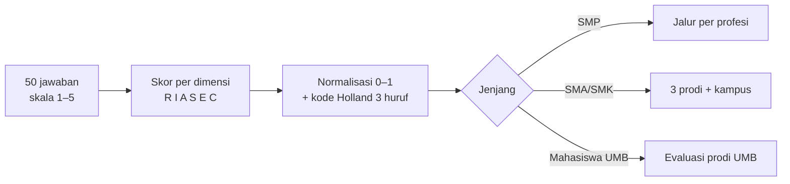
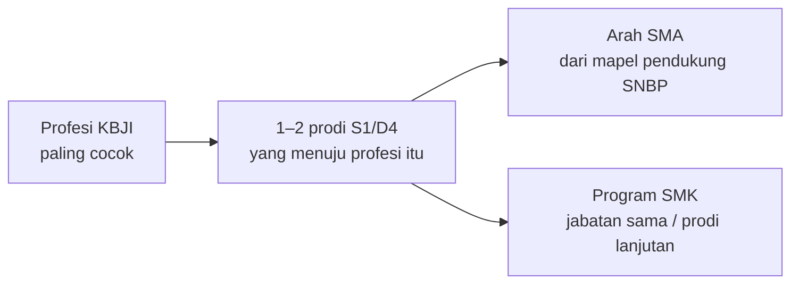

<div align="center">

# 🧭 ArahDiri

**Kenali minatmu, temukan arah pendidikan dan kariermu.**

Aplikasi web panduan penjurusan dan karier berbasis tes minat **RIASEC (Holland)**
untuk siswa SMP, siswa SMA/SMK, dan mahasiswa Universitas Mercu Buana.


</div>

---

## Daftar isi

1. [Apa itu ArahDiri?](#-apa-itu-arahdiri)
2. [Fitur utama](#-fitur-utama)
3. [Cara kerja mesin rekomendasi](#-cara-kerja-mesin-rekomendasi)
4. [Sumber data dan rujukan](#-sumber-data-dan-rujukan)
5. [Teknologi yang digunakan](#-teknologi-yang-digunakan)
6. [Menjalankan di laptop (lokal)](#-menjalankan-di-laptop-lokal)
7. [Perintah penting](#-perintah-penting)
8. [Struktur folder](#-struktur-folder)
9. [Status pengembangan](#-status-pengembangan)
10. [Catatan penting](#-catatan-penting)

---

## 🌱 Apa itu ArahDiri?

Banyak siswa memilih jurusan karena ikut teman, tebakan, atau tekanan dari luar, lalu baru sadar di tengah jalan bahwa pilihannya tidak cocok. **ArahDiri** membantu langkah awal itu. Siswa mengerjakan tes minat 50 pernyataan, lalu mendapat rekomendasi yang **bersambung dari minat sampai pekerjaan**:

| Pengguna | Pertanyaan yang dijawab ArahDiri | Yang diterima |
|---|---|---|
| **Siswa SMP** | "Aku cocok jadi apa, dan sebaiknya masuk SMA atau SMK apa?" | 3 profesi yang paling cocok, masing-masing dengan **jalur mundurnya**: arah SMA atau program SMK → prodi kuliah → profesi |
| **Siswa SMA/SMK** | "Jurusan kuliah apa yang cocok, dan di kampus mana?" | 3 prodi dengan karier utama berbeda, masing-masing dengan 1 kampus berakreditasi, ditambah pilihan prodi di UMB |
| **Mahasiswa UMB** | "Apakah prodiku sekarang sudah cocok?" | Posisi prodimu di antara prodi UMB lain, 3 prodi UMB paling cocok, dan karier dari prodimu sekarang |

> ArahDiri adalah **alat bantu awal**, bukan pengganti guru BK, konselor, atau orang tua. Persentase yang ditampilkan menunjukkan **keselarasan profil minat**, bukan peluang diterima.

---

## ✨ Fitur utama

**Untuk siswa**
- Tes minat RIASEC 50 butir. Jawaban tersimpan setiap kali dipilih, jadi tes bisa dilanjutkan kalau terputus.
- Halaman hasil dengan tab **Jurusan**, **Karier**, dan **Kampus**, ditambah ringkasan yang mudah dibaca.
- **Unduh PDF** hasil (tanpa pustaka PDF di server, memakai dialog cetak browser).
- **Riwayat** tes, **favorit** (prodi/karier/kampus), dan **rencana pengembangan** berupa daftar target yang bisa dicentang.
- **Katalog publik** tanpa akun: jurusan, karier, kampus, dan program SMK.
- Tombol **"Laporkan hasil tidak sesuai"** yang masuk ke kotak masuk admin tanpa identitas siswa.

**Untuk admin dan guru BK**
- Ringkasan agregat dan panel **kesehatan data** (sinkron BAN-PT, akreditasi kedaluwarsa, laporan baru).
- **Simulator rekomendasi**: atur skor RIASEC dan jenjang, lalu lihat hasilnya tanpa menyimpan apa pun.
- **Penyunting katalog** (karier, prodi, mapel pendukung, program SMK, arah SMA) dan **penyunting konten**.
- **Aturan rekomendasi** yang bisa dinyalakan atau dimatikan tanpa mengubah kode.
- Manajemen pengguna (data minimal, email disamarkan) dan **kata sandi sementara** untuk akun yang lupa sandi.
- Peran berjenjang: `editor` (guru BK), `admin`, `owner`. Ada juga **catatan aktivitas** untuk setiap perubahan.

---

## 🧠 Cara kerja mesin rekomendasi

Kode mesin ada di [`app/Services/Recommendation`](app/Services/Recommendation). Versi yang berlaku sekarang adalah **`rec-v4`**. Setiap rekomendasi disimpan bersama versinya, sehingga hasil lama tetap bisa dibaca dan dibedakan.

### Gambaran umum



### Langkah 1: Menghitung skor minat

1. Setiap pernyataan dinilai 1–5 (*Tidak Menarik* sampai *Sangat Menarik*) dan masuk ke salah satu dari 6 dimensi: **R**ealistic, **I**nvestigative, **A**rtistic, **S**ocial, **E**nterprising, **C**onventional.
2. Skor mentah tiap dimensi dijumlahkan, lalu dibagi skor maksimum dimensi itu, sehingga hasilnya berskala **0–1**.
3. **Kode Holland** adalah 3 dimensi tertinggi. Kalau ada nilai yang sama, urutannya dipecah dengan skor mentah, lalu urutan R-I-A-S-E-C.

### Langkah 2: Mengukur kecocokan

Setiap profesi (KBJI), prodi, program SMK, dan arah SMA punya **profil RIASEC** sendiri. Profil dari O\*NET berskala 1–7, jadi dinormalkan dulu dengan rumus `(nilai − 1) / 6`. Kecocokan antara profil siswa (**u**) dan profil target (**t**) dihitung dengan rumus:

```
kecocokan = 0,5 × kemiripan_kosinus(u, t)  +  0,5 × tumpang_tindih_3_teratas(u, t) / 14
```

- **Kemiripan kosinus** menilai kemiripan bentuk keseluruhan profil.
- **Tumpang tindih 3 teratas** memberi bobot 3, 2, dan 1 pada peringkat 1–3. Hasil kali bobot untuk dimensi yang sama di kedua profil dijumlahkan, lalu dibagi nilai maksimumnya, yaitu 14 (3×3 + 2×2 + 1×1). Bagian ini memastikan minat yang paling menonjol benar-benar sejalan.

Rumus ini dibuat sama persis dengan ArahDiri v14 agar hasilnya konsisten.

### Langkah 3a: SMP, jalur per profesi (dihitung mundur dari cita-cita)



1. **Profesi.** Semua jabatan KBJI yang punya profil RIASEC dan terhubung ke prodi diberi peringkat kecocokan. Dipilih **3 profesi dari kelompok jabatan berbeda** (3 digit pertama kode KBJI), agar pilihannya beragam. Profesi khusus keagamaan, dosen, dan kategori "lainnya/ytdl" tidak dimunculkan. Aturan ini bisa diubah admin.
2. **Prodi kuliah.** Untuk tiap profesi diambil 1–2 prodi S1/D4 dari tabel keterkaitan prodi→jabatan. Urutannya: tingkat keterkaitan, lalu kecocokan minat, lalu S1 lebih dulu, lalu jumlah kampus yang membuka.
3. **Arah SMA.** Mapel pendukung prodi diambil dari **Kepmendikdasmen 102/M/2025**, lalu dipetakan ke arah IPA/IPS/Bahasa yang memuat mapel itu. Contohnya, Teknik Sipil membutuhkan Matematika Tingkat Lanjut dan Fisika, jadi arahnya **IPA**. Kalau prodinya tidak membutuhkan mapel khas, arah dipilih dari kecocokan minat.
4. **Program SMK.** Ada dua jalan: program SMK yang lulusannya bekerja di **jabatan yang sama**, atau program SMK yang sejalan dengan **nama prodi lanjutannya**. Kalau tidak ada yang linear, hasil dengan jujur menyarankan jalur SMA.

### Langkah 3b: SMA/SMK, prodi dan kampus

1. Semua kelompok prodi S1/D4/D3 diberi peringkat kecocokan. Skor dibulatkan ke persen agar prodi langka tidak menang hanya karena selisih 0,0x%.
2. Diambil **3 prodi dengan karier utama berbeda**, sehingga siswa melihat 3 arah yang benar-benar lain.
3. Tiap prodi diberi **1 kampus berbeda** dengan urutan berikut:
   **akreditasi prodi → akreditasi kampus → PTN/PTKN dulu → masa berlaku akreditasi terpanjang → nama**.
   Prodi dan kampusnya wajib berakreditasi aktif menurut BAN-PT.
4. **Promosi UMB**: ditampilkan terpisah tanpa mengubah urutan, yaitu prodi UMB dari rumpun yang sama atau yang mengarah ke karier yang sama.

### Langkah 3c: Mahasiswa UMB, evaluasi prodi

- Posisi prodi yang sedang dijalani di antara semua prodi UMB sejenjang.
- 3 prodi UMB paling cocok. Untuk mahasiswa D3 ditambah jalur lanjutan ke S1.
- **"Bertahan sambil belok arah"**: 3 karier dari prodi sekarang yang paling sesuai minat.

### Prinsip yang dijaga

- **Transparan**: setiap rekomendasi menyimpan alasannya (dimensi yang cocok, mapel yang menyambungkan, cara SMK terhubung).
- **Tidak menebak**: tanpa data akreditasi, prodi tetap direkomendasikan dengan status "menunggu data akreditasi".
- **Tidak menanyakan agama**, sehingga prodi atau profesi khusus agama tertentu tidak direkomendasikan otomatis.
- **Bisa diaudit**: suntingan admin tercatat, dan simulator berjalan di dalam transaksi database yang selalu dibatalkan.

---

## 📚 Sumber data dan rujukan

| Sumber | Dipakai untuk |
|---|---|
| **Teori minat karier Holland (RIASEC)**: J. L. Holland, *Making Vocational Choices* (1997) | Kerangka 6 tipe minat dan kode Holland |
| **Instrumen RIASEC 50 butir ArahDiri** (dari ArahDiri v14, `config/riasec.php`) | Butir tes dan skala jawaban |
| **O\*NET 31.0 Interest Profiles**, U.S. Department of Labor/ETA (lisensi CC BY 4.0) | Profil RIASEC jabatan, lewat padanan KBJI → O\*NET |
| **KBJI 2026** (Klasifikasi Baku Jabatan Indonesia), BPS–Kemnaker | Daftar 2.380 jabatan/profesi |
| **PDDikti**, Kemdiktisaintek | 4.303 perguruan tinggi dan 34.711 prodi per kampus |
| **Direktori Akreditasi BAN-PT** | Peringkat dan masa berlaku akreditasi prodi dan kampus |
| **Spektrum Keahlian SMK/MAK**, Kepmendikbudristek 244/M/2024 | Program dan konsentrasi keahlian SMK |
| **Mapel Pendukung Prodi SNBP**, Kepmendikdasmen 102/M/2025 (29 Juli 2025) | Menyambungkan arah SMA dengan prodi kuliah, termasuk Diktum KETIGA untuk lulusan SMK |

Data katalog disimpan sebagai CSV di [`database/data/`](database/data) dan dimuat dengan `php artisan catalog:import`. Sebagian padanan prodi→jabatan dan peta SMK→prodi masih berstatus **draf** dan perlu ditelaah guru BK. Penelaahan bisa dilakukan langsung lewat menu **Katalog** di panel admin.

---

## 🛠 Teknologi yang digunakan

| Lapisan | Teknologi |
|---|---|
| Bahasa server | **PHP 8.5.12+** |
| Framework backend | **Laravel 13** |
| Penghubung backend–frontend | **Inertia.js 3** (aplikasi satu halaman tanpa API terpisah) |
| Frontend | **Vue 3** (Composition API, `<script setup>`) |
| Build tool | **Vite 8** + `laravel-vite-plugin` |
| Tampilan | CSS ArahDiri v14 (dipakai apa adanya) + penyesuaian `v2.css` dan `admin.css` |
| Database | **MySQL 8** / MariaDB 10.6+ (pengujian memakai SQLite) |
| Pengujian | **PHPUnit 12** (48 tes fitur dan unit) |
| Format kode | Laravel Pint |
| Penjadwal | Laravel Scheduler (cron) untuk sinkron BAN-PT mingguan |
| Target hosting | Shared hosting cPanel (Rumahweb) |

---

## 💻 Menjalankan di laptop (lokal)

### Prasyarat

- **PHP 8.5.12+** dengan ekstensi `pdo_mysql`, `mbstring`, `intl`, `fileinfo` (dan `pdo_sqlite` untuk tes)
- **Composer** 2
- **Node.js 22+** dan npm
- **MySQL 8** atau MariaDB 10.6+
- **Git**

> 💡 Di Windows, cara termudah adalah memasang **[Laragon](https://laragon.org)** atau **[Laravel Herd](https://herd.laravel.com)**. Keduanya sudah membawa PHP, Composer, dan MySQL.

### 1. Clone repositori

```bash
git clone https://github.com/ptramdhn/arahdiri.git
cd arahdiri
```

### 2. Siapkan database

Buat database kosong bernama `arahdiri` dengan collation `utf8mb4_unicode_ci`. Kamu bisa memakai HeidiSQL, phpMyAdmin, atau perintah berikut:

```sql
CREATE DATABASE arahdiri CHARACTER SET utf8mb4 COLLATE utf8mb4_unicode_ci;
```

### 3. Pasang dependensi dan konfigurasi

```bash
composer install
cp .env.example .env          # Windows CMD: copy .env.example .env
php artisan key:generate
```

Buka `.env`, lalu sesuaikan koneksi database kalau berbeda:

```dotenv
DB_DATABASE=arahdiri
DB_USERNAME=root
DB_PASSWORD=
```

### 4. Buat tabel dan muat katalog

```bash
php artisan migrate
php artisan catalog:import
```

### 5. Bangun tampilan

```bash
npm install
npm run build
```

### 6. Jalankan aplikasi

```bash
composer dev
```

Perintah ini menjalankan server Laravel dan Vite sekaligus. Buka **http://localhost:8000**.

> Langkah 3–5 juga bisa dijalankan sekaligus dengan `composer setup`.

### 7. Buat akun owner pertama

```bash
php artisan arahdiri:make-admin namaadmin admin@contoh.id 081234567890 --owner
```

Kata sandi akan ditanyakan di terminal. Masuk dengan akun ini, lalu buka **/admin**. Admin dan editor (guru BK) berikutnya cukup mendaftar sebagai pengguna biasa, lalu owner menaikkan perannya di menu **Akun admin**.

### 8. (Opsional) Ambil data akreditasi BAN-PT

```bash
php artisan banpt:sync
```

Tanpa langkah ini, aplikasi tetap berjalan. Rekomendasi kampus hanya akan berstatus "menunggu data akreditasi".

### 9. Jalankan tes otomatis

```bash
php artisan test
```

---

## ⌨ Perintah penting

| Perintah | Fungsi |
|---|---|
| `composer dev` | Menjalankan server lokal dan Vite (mode pengembangan) |
| `npm run build` | Membangun aset tampilan untuk produksi |
| `php artisan test` | Menjalankan seluruh tes otomatis |
| `php artisan catalog:import` | Memuat ulang katalog CSV (aman diulang; baris yang disunting admin tidak ditimpa) |
| `php artisan banpt:sync` | Mengunduh dan mencocokkan data akreditasi BAN-PT |
| `php artisan banpt:sync --export` / `--import` | Unduh JSON mentah di satu tempat, impor di tempat lain (misalnya laptop → hosting) |
| `php artisan arahdiri:make-admin {username} {email} {hp} [--owner]` | Membuat akun admin atau owner |
| `php artisan schedule:run` | Dipanggil cron setiap menit di hosting (sinkron BAN-PT tiap Minggu 02.30) |

---

## 📁 Struktur folder

```
app/
├── Console/Commands/        catalog:import, banpt:sync, arahdiri:make-admin
├── Http/Controllers/        halaman siswa + Admin/ (simulator, katalog, konten, pengguna, …)
├── Http/Middleware/         peran, onboarding, wajib ganti kata sandi
├── Models/                  pengguna, tes, rekomendasi, katalog, akreditasi
├── Services/
│   ├── Recommendation/      ⭐ mesin rekomendasi + pemilih kampus
│   ├── Banpt/               pencocokan nama BAN-PT ↔ katalog
│   └── RiasecScorer.php     perhitungan skor tes
└── Support/                 rumus RIASEC, mapel pendukung, arah SMA, peta SMK, pengaturan
config/
├── riasec.php               50 butir tes dan skala
├── mapel_pendukung.php      mapel pendukung SNBP (Kepmendikdasmen 102/M/2025)
├── sma_tracks.php           arah SMA dan profil RIASEC-nya
└── smk_lanjutan.php         program SMK → prodi lanjutan
database/
├── data/                    CSV katalog (KBJI, PDDikti, SMK, …)
└── migrations/
resources/
├── css/                     CSS v14, v2.css, admin.css
├── js/Pages/                halaman Inertia (Vue)
├── js/Components/           komponen hasil, admin, dll.
└── views/cetak.blade.php    tampilan PDF hasil
tests/                       tes fitur dan unit
```

---

## 🚦 Status pengembangan

| Tahap | Isi | Status |
|---|---|---|
| 1 | Fondasi: database, impor katalog, akun, tampilan v14, beranda, pencarian | ✅ Selesai |
| 2 | Tes 50 butir (bisa dilanjutkan), skor, kode Holland, halaman hasil | ✅ Selesai |
| 3 | Mesin rekomendasi per jenjang, tab Jurusan/Karier/Kampus, sinkron BAN-PT | ✅ Selesai |
| 4 | PDF, riwayat, favorit, rencana pengembangan, katalog publik, profil, panel admin lengkap | ✅ Selesai |
| 5 | Deploy ke shared hosting | ⏳ Berikutnya |

---

## ⚠ Catatan penting

- **BAN-PT**: `robots.txt` BAN-PT melarang akses otomatis ke `/direktori/`. Jalankan `banpt:sync` paling sering seminggu sekali, dan **minta izin atau data resmi BAN-PT sebelum rilis publik**.
- **Penjurusan SMA** direncanakan kembali tahun 2027. Label arah IPA/IPS/Bahasa akan disesuaikan setelah aturannya terbit.
- **Data draf**: padanan prodi→jabatan berstatus `draft_ai` dan peta SMK→prodi perlu ditelaah guru BK sebelum dipakai luas.
- **Privasi**: jawaban dan hasil per siswa tidak ditampilkan di panel admin. Ekspor data memakai ID acak, dan email pengguna disamarkan.
- **Jangan commit `.env`**, karena berisi kunci aplikasi dan kata sandi database.

---

<div align="center">
<sub>ArahDiri v2 · dibangun dengan Laravel, Inertia, dan Vue</sub>
</div>
